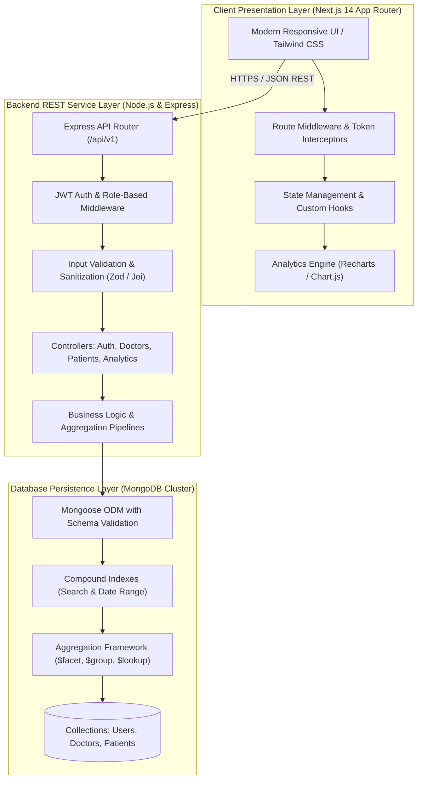

# 🏥 DOCTOR TRACKER — ENTERPRISE SOFTWARE ENGINEERING SPECIFICATION
**Organization:** Care Guide BD | **Document:** Software Requirements Specification (SRS) & Architecture Artifact  
**Standard:** IEEE 830 / ISO/IEC/IEEE 29148 Compliant  
**Version:** 1.0.0 | **Date:** November 17, 2026  

---

## 1. Executive Summary & Purpose
**Doctor Tracker** is an administrative healthcare SaaS portal designed for clinical operational supervisors, clinic coordinators, and healthcare administrators. It establishes a performant, fault-tolerant, and secure administrative platform to manage healthcare providers (doctors), linked patient assignments, clinical records, and real-time analytical workload distribution.

---

## 2. Stakeholder Identification & Matrix

```
                    [ Care Guide BD Leadership ]
                                 |
        +------------------------+------------------------+
        |                                                 |
  (Operational)                                      (Technical)
        |                                                 |
        v                                                 v
Clinical Supervisors / Admins                      Full-Stack Engineering
(Primary End-Users)                                (DevOps & Code Review)
```

| Stakeholder Role | Classification | Primary Interest & Responsibility | Key Expectations |
| :--- | :--- | :--- | :--- |
| **System Administrator** | Internal / Direct User | Manages doctor profiles, assigns incoming patients, and reviews clinical workload. | Fast loading, 0-latency debounced search, intuitive UI. |
| **Clinical Supervisor** | Internal / Supervisor | Audits patient assignment ratios, monitors critical conditions, and trends. | Actionable data visualizers, clear charts, date-based filtering. |
| **Technical Interview Panel (Care Guide BD)** | Evaluator / Audit | Assesses code quality, architectural decoupling, query optimization, security. | Clean code, proper MongoDB indexing, REST design, complete docs. |
| **Healthcare Compliance / DevOps** | Governance | Ensures patient data integrity, JWT authentication, and zero-downtime hosting. | Stateless JWT, HTTPS, environment isolation, input sanitization. |

---

## 3. High-Level System Architecture



---

## 4. Software Requirements Specification (SRS)

### 4.1 Functional Requirements (FR)

| Req ID | Module | Functional Specification | Priority |
| :--- | :--- | :--- | :---: |
| **FR-AUTH-01** | Authentication | The system shall provide an admin authentication interface utilizing email and password credentials. | P0 |
| **FR-AUTH-02** | Security | The system shall issue cryptographically signed JWT tokens and enforce route protection across all private endpoints. | P0 |
| **FR-AUTH-03** | Session Mgmt | The client application shall detect expired tokens and automatically redirect unauthorized sessions to `/login`. | P0 |
| **FR-DOC-01** | Doctor Registry | Admin shall register a doctor with: Name, Specialization, Hospital, Phone, and Email with strict schema validation. | P0 |
| **FR-DOC-02** | Doctor Search | The system shall provide debounced full-text search across doctor names, specializations, and affiliated hospitals. | P0 |
| **FR-DOC-03** | Doctor Filter | The system shall filter doctors by creation date range and clinical specialization with pagination. | P1 |
| **FR-DOC-04** | Linked Patients | The doctor detail view shall display all active patients currently assigned under that specific doctor. | P0 |
| **FR-DOC-05** | Direct Patient Addition | Admin shall be able to assign a new patient directly within a doctor's profile modal. | P1 |
| **FR-DOC-06** | Patient Unlinking | Admin shall be able to remove or reassign a patient from a doctor's active registry. | P1 |
| **FR-PAT-01** | Patient Directory | The system shall maintain a dedicated global patient catalog with pagination ($N=10$ per page). | P0 |
| **FR-PAT-02** | Patient Editing | Admin shall update patient demographic, clinical condition, and doctor assignment details. | P1 |
| **FR-PAT-03** | Patient Deletion | Admin shall remove patient records with a confirmation safety modal to prevent accidental data loss. | P1 |
| **FR-PAT-04** | Clinical Filter | The system shall filter patients by condition (`Stable`, `Critical`, `Under Observation`, `Discharged`) and date. | P1 |
| **FR-PAT-05** | Patient Search | The system shall provide debounced full-text search across patient names, contact numbers, and assigned doctor names on the dedicated Patient page. | P0 |
| **FR-ANL-01** | Metric Cards | The dashboard shall display real-time metric counters: Total Doctors, Total Patients, and Average Load per Doctor. | P0 |
| **FR-ANL-02** | Patient-Doctor Chart | The dashboard shall visualize doctor workload using a responsive Bar Chart. | P1 |
| **FR-ANL-03** | Temporal Analytics | The dashboard shall visualize admission and registration velocity over time using an Area / Line Chart. | P1 |
| **FR-ANL-04** | Condition Distribution | The dashboard shall render a Doughnut / Pie Chart illustrating proportional clinical condition states. | P1 |

### 4.2 Non-Functional Requirements (NFR)

| Req ID | Category | Requirement Detail | Verification Metric |
| :--- | :--- | :--- | :--- |
| **NFR-PERF-01** | Performance | API endpoints for search and pagination must resolve in under $150\text{ms}$ under typical payload loads. | MongoDB Compound Indexing & Query Benchmarking |
| **NFR-PERF-02** | Client Efficiency | Frontend bundle shall minimize re-renders using memoization (`useMemo`, `useCallback`) and optimized component trees. | React Profiler < $16\text{ms}$ frame budget |
| **NFR-SEC-01** | Data Protection | Passwords must be hashed using `bcrypt` (salt rounds $\ge 10$). All user inputs sanitized against NoSQL injection and XSS. | Zero unescaped string sinks; strict regex |
| **NFR-RESP-01** | Usability | Responsive layout conforming to Mobile ($375\text{px}$), Tablet ($768\text{px}$), and Desktop ($1280\text{px}+$). | Lighthouse Mobile & Desktop Score $\ge 90$ |
| **NFR-DOC-01** | Maintainability | Standardized repository README documenting elevator pitch, setup instructions, architecture, and engineering trade-offs. | Verified against assignment rubric |

---

## 5. Work Breakdown Structure (WBS)

```
Doctor Tracker System
│
├── 1.0 Engineering Architecture & Specifications
│   ├── 1.1 SRS & Traceability Matrix Compilation
│   ├── 1.2 ERD & MongoDB Schema Design
│   └── 1.3 REST API Interface Specification
│
├── 2.0 Backend Infrastructure (Node.js / Express / MongoDB)
│   ├── 2.1 Database Connection & Compound Index Setup
│   ├── 2.2 JWT Authentication & Middleware Pipeline
│   ├── 2.3 Doctor CRUD & Sub-Collection Aggregation
│   ├── 2.4 Patient CRUD & Filtering Micro-queries
│   └── 2.5 Analytics Aggregation Pipelines ($facet)
│
├── 3.0 Frontend Application (Next.js App Router / Tailwind)
│   ├── 3.1 Design System, Layout & Navigation Shell
│   ├── 3.2 Authentication Views & Context State
│   ├── 3.3 Doctor Management Interface (Cards, Tables, Modals)
│   ├── 3.4 Patient Management Interface (Multi-Filter Table)
│   └── 3.5 Interactive Visual Analytics Dashboard (Recharts)
│
├── 4.0 Testing, Optimization & Deployment
│   ├── 4.1 Query Profiling & Index Optimization
│   ├── 4.2 Cross-Device Responsiveness Audit
│   ├── 4.3 Backend Deployment (Render / VPS)
│   └── 4.4 Frontend Deployment (Vercel)
│
└── 5.0 Documentation & Submission Delivery
    ├── 5.1 Standardized README.md with Architecture
    ├── 5.2 Seeding Script for Sample Data
    └── 5.3 Video Walkthrough / Screen Evidence Capture
```

---

## 6. Requirements Traceability Matrix (RTM)

This matrix maps user business requirements directly to system functional modules, database schemas, API routes, and verification tests:

| Requirement ID | Requirement Description | Architecture Module | Database Schema / Index | REST API Endpoint | Test Verification Case |
| :--- | :--- | :--- | :--- | :--- | :--- |
| **RTM-01** | Secure User Login | Auth Middleware & Context | `UserSchema` (email index) | `POST /api/v1/auth/login` | TC-AUTH-001 (Valid & Invalid credentials) |
| **RTM-02** | Doctor Creation & Validation | Doctor Controller | `DoctorSchema` (email, phone) | `POST /api/v1/doctors` | TC-DOC-001 (Field completeness & duplicate checks) |
| **RTM-03** | Doctor Search & Pagination | Query Optimizer | `{ name: "text", specialization: "text" }` | `GET /api/v1/doctors?search=&page=` | TC-DOC-002 (Text search speed & limit boundary) |
| **RTM-04** | Patient Assignment to Doctor | Doctor Sub-service | `PatientSchema` (doctorId foreign key) | `POST /api/v1/doctors/:id/patients` | TC-DOC-003 (Cascading assignment integrity) |
| **RTM-05** | Global Patient Directory & Filters | Patient Controller | `{ condition: 1, createdAt: -1 }` | `GET /api/v1/patients?condition=` | TC-PAT-001 (Multi-parameter query filtering) |
| **RTM-06** | Patient Record Mutation & Deletion | Patient Controller | `PatientSchema` (id lookup) | `PUT / DELETE /api/v1/patients/:id` | TC-PAT-002 (Mutation reflection & modal validation) |
| **RTM-07** | High-Performance Analytics Aggregation | Analytics Pipeline | Compound Indexes on `Doctor` & `Patient` | `GET /api/v1/analytics/dashboard` | TC-ANL-001 ($facet single-pass aggregation query) |
| **RTM-08** | Client Route Guarding | Next.js Middleware | LocalStorage / Secure HTTP Cookie | Client-Side Router | TC-SEC-001 (Direct URL access without JWT) |
| **RTM-09** | Patient Search (Debounced Full-Text) | Patient Controller & Query Optimizer | `{ name: "text", contactNumber: 1 }` compound index | `GET /api/v1/patients?search=&page=` | TC-PAT-003 (Text search accuracy & debounce latency) |

---

## 7. Data Model / Entity Relationship Design

```
+-----------------------------------+         +-------------------------------------+
|              DOCTOR               |         |               PATIENT               |
+-----------------------------------+         +-------------------------------------+
| _id: ObjectId [PK]                | 1     * | _id: ObjectId [PK]                  |
| name: String (Indexed)            |---------| doctorId: ObjectId [FK -> Doctor]   |
| specialization: String (Indexed)  |         | name: String                        |
| hospital: String                  |         | age: Number                         |
| phone: String                     |         | gender: String                      |
| email: String (Unique)            |         | condition: Enum (Stable/Critical..) |
| createdAt: ISODate (Indexed)      |         | contactNumber: String               |
| updatedAt: ISODate                |         | admissionDate: ISODate (Indexed)    |
+-----------------------------------+         +-------------------------------------+
```

---
*Document compiled and verified under T-REX Elite Engineering Protocol.*
